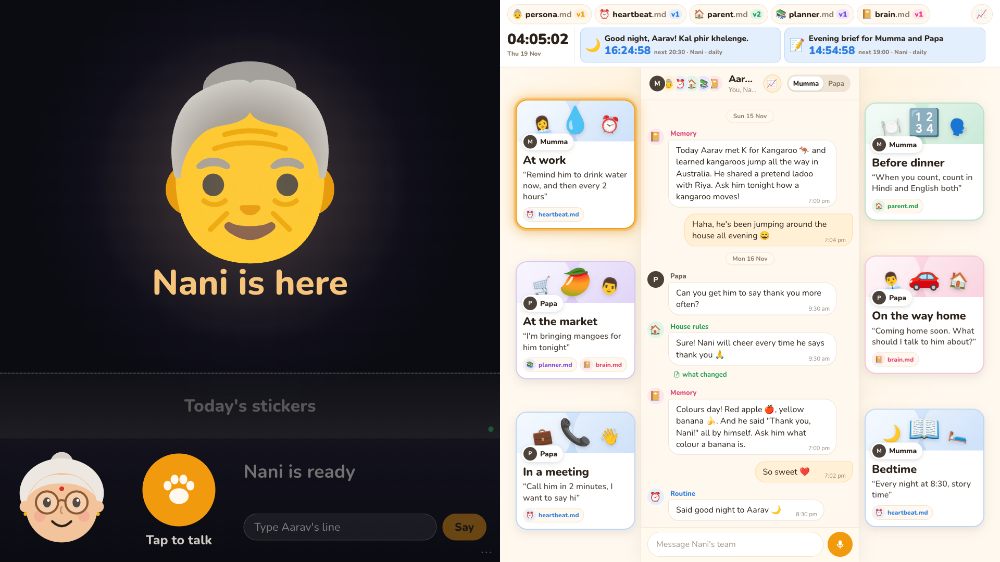
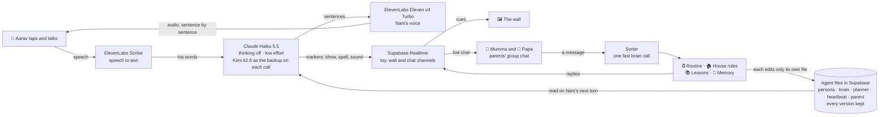

# Tutor Grandma

**with Nani 👵**

> A grandma who teaches the way grandmas do, for every child.
> A group chat that lets parents guide, not control.

**[Live stage](https://tutor-nani.vercel.app/stage)** · **[Parents' chat](https://tutor-nani.vercel.app/)** · **[Tech pitch](https://tutor-nani.vercel.app/pitch.html)**



## Why

> My grandmother taught Marathi and mathematics for 50 years.

Tutor Grandma brings her way of teaching to every child: in the language of home, through play, in a grandma's voice.
And it keeps the family in the loop, so every lesson leads back to Mumma and Papa.

## The problem

- Ages 5 to 8 learn by listening, and the move from the home language to English happens then.
- A phone is the wrong teacher at that age, and good play school is out of reach for most families.
- Parents can't guide a child's AI in real time, and presets can't keep up with a child who changes every day.

## Our belief

> AI already teaches IQ. We build EQ: every lesson becomes a reason to run to Mumma and Papa. Parents guide; they don't control.

## What we built

**1. Nani, the voice agent.** Aarav taps and talks. Nani hears him, thinks, and answers in a grandma's voice: Hindi first, English next, two short sentences and a question. Grandma fillers cover every wait.

**2. The wall.** A projector home base that shows what Nani talks about: a moon, a lion, the letter tiles for _OON, counting in two languages, a cheer when he gets it.

**3. The heart: the agents and the parents' group chat.** Mumma and Papa write in a group chat with Nani's team, in their own words, whenever they like. Four AI agents listen: ⏰ **Routine**, 🏠 **House rules**, 📚 **Lessons** and 📔 **Memory**. Each one owns one of Nani's files.

> Parents say it → the agent writes it in its file → Nani does it, and reports back in the chat.

That chat is the guidance system. Nothing is a preset: a parent can change Nani mid-morning, and Nani follows it on her very next turn.

## One day with Aarav

| Moment | What happens | How it brings the family closer |
|---|---|---|
| **Chand → Moon** | Aarav: "Nani, raat ko Papa aayenge!" Nani: "Raat ko aasmaan mein aur kaun aata hai?" "Chand!" "Chand ko English mein Moon kehte hain. M for Moon!" The wall shows a moon, then _OON and three tiles. He picks M. | The English word grows out of his own Hindi word, and out of waiting for Papa. |
| **Mumma's water reminder** | From work, Mumma writes "Remind him to drink water now, and then every 2 hours". ⏰ Routine adds the job; Nani reminds him at once, and again two hours later. Routine posts his answer: "Pee liya abhi!" 💧 | Mumma's care reaches him in Nani's voice, and she hears back that he drank. |
| **Counting in Hindi and English** | Mumma: "When you count, count in Hindi and English both." 🏠 House rules adds the line and keeps every version. Then: "Ek, one! Do, two! Teen, three!" and the wall counts in both. | The home language stays next to English, by the family's own rule. |
| **Papa's mangoes → M for Mango** | **From the market, Papa writes "I'm bringing mangoes for him tonight". 📚 Lessons changes today's plan and 📔 Memory notes it. Next game, Nani moves to M se Mango and keeps the surprise.** | **Papa's gift tonight becomes today's lesson, and the surprise stays his to give.** |
| **The roar for Mumma** | Aarav asks how a lion roars, the lion comes up on the wall, and Nani cheers his roar. "Mumma ko roar sunana hai!" After his "Haan!", a call opens in the chat and Mumma joins to hear it. | A lesson becomes a reason to run to Mumma. |
| **"What should I talk to him about?"** | On his way home, Papa asks. 📔 Memory answers with today's real moments and three bedtime questions, plus a 📈 progress card: today, this week, this month. | Papa walks in knowing what to ask him. |

The full stage script, step by step, is in [docs/thinking-partner/DEMO.md](docs/thinking-partner/DEMO.md).

## How it works



A child turn is one request, `POST /api/turn`, answered as a stream of sentences, each with its wall cue ([docs/toy-contract.md](docs/toy-contract.md)). Nani steers the wall with small markers in her reply, like `[[show 🌙 Moon]]` or `[[spell MOON 1 M S T]]`.

**The agent files.** One agent per child, five files, each change stored as a new version in Supabase (`agent_files`).

| File | What it holds | Who writes it |
|---|---|---|
| `persona.md` | Nani's ways: how she talks, the wall, kind rules, and that she is an AI Nani | Set at the start; no agent edits it |
| `heartbeat.md` | Routine's list: reminders, calls, bedtime and the evening brief, one job per line | ⏰ Routine |
| `parent.md` | House rules: language, tone, examples and what to avoid | 🏠 House rules |
| `planner.md` | Today's plan: the letter of the day, the theme and the play-time steps | 📚 Lessons |
| `brain.md` | Aarav's memory: what he knows, what he loves and what happened lately | 📔 Memory |

## Stack

| Layer | What we use | Version or model id |
|---|---|---|
| Web app | Next.js, React, Tailwind CSS | `16.4.6`, `19.3.0`, `4.3.3` |
| Data and live updates | Supabase (Postgres and Realtime), supabase-js | `^2.119.0` |
| Hearing | ElevenLabs Scribe | `scribe_v3` |
| Nani's voice | ElevenLabs Eleven v4 Turbo (live), Eleven v4 (pre-made lines) | `eleven_v4_turbo`, `eleven_v4` |
| Brain | Claude Haiku 5.5, through @anthropic-ai/sdk `^1.12.0` | `claude-haiku-5-5` |
| Backup brain | Kimi k2.6 | `kimi-k2.6` |
| Hosting | Vercel, functions in Mumbai | `bom1` |
| Package manager | pnpm | `10.33.2` |

## Measured

On **22 November 2026**, through the browser, no toy ([NOW.md](docs/thinking-partner/NOW.md)):

| Check | Result |
|---|---|
| Median time to first audio, same 4 lines | **2.45 s** (Kimi on the same lines: 3.18 s) |
| Stage script, steps 1 to 15 | **15 of 15** |
| Turns that fell back to Kimi | **0 of 20** |

## Honest notes

- Nani's voice in the demo is an ElevenLabs library voice standing in for the family's cloned grandma.
- In the product, Nani lives in a plush toy and the wall on a projector. Here both run in the browser (`/toy`, `/home-base`, and together on `/stage`) on the same toy contract ([docs/toy-contract.md](docs/toy-contract.md)).
- The earlier weeks in the progress report are sample history; today is live.

## Built with Claude Code

The founder ran the whole build by voice through one Claude Code Coordinator, with builder, expert, reviewer and scout subagents. The roster is in [CLAUDE.md](CLAUDE.md) and [.claude/agents/](.claude/agents/).

Every plan, contract and run log is in [docs/plan/](docs/plan/). Every decision is in [docs/thinking-partner/DECISIONS.md](docs/thinking-partner/DECISIONS.md), one line each with its reason. The docs index is [docs/README.md](docs/README.md).

## Repo map

| Folder | What's there |
|---|---|
| [`apps/web`](apps/web) | The Next.js app: the parents' chat (`/`), the stage (`/stage`), the toy stand-in (`/toy`), the projector wall (`/home-base`), the presenter page (`/presenter`) and the API routes. Shared code is in `apps/web/lib`; the tech pitch is `apps/web/public/pitch.html`. |
| [`content`](content) | All demo content: settings, models and voice (`demo.config.json`), the seed files and chat that `/api/reset` restores (`seed.json`), the pre-made audio list, the agent profiles and the sample progress history. |
| [`agent/templates`](agent/templates) | One-line first sketches of the five files. The live versions are seeded from `content/seed.json` into Supabase. |
| [`supabase`](supabase) | Migrations (the five tables, the public `audio` bucket, Realtime) and the project config. |
| [`scripts`](scripts) | `audio/` makes the pre-made audio with ElevenLabs, `progress/` writes the sample history, `selftest/` runs the stage script and checks against the live site. |
| [`docs`](docs) | Plans, contracts and run logs, the thinking partner's notes, the pitch brief and the toy contract. See [docs/README.md](docs/README.md). |
| [`firmware`](firmware) | Experimental, not part of the demo: our own small ESP32-S3 firmware and a laptop bridge. |
| [`.claude`](.claude) | The Claude Code setup: subagents, commands and settings. |

## Run it yourself

1. Install and start (pnpm `10.33.2`):
   ```bash
   pnpm install
   pnpm dev
   ```
2. Copy [`apps/web/.env.example`](apps/web/.env.example) to `apps/web/.env.local` and fill in your own keys: Supabase, ElevenLabs, Anthropic and Kimi.
3. Create a Supabase project and apply the migrations in [`supabase/migrations`](supabase/migrations).
4. Seed the files and the chat:
   ```bash
   curl -X POST http://localhost:3000/api/reset
   ```
   Once it's deployed, use your own host in place of `http://localhost:3000`.
5. Open `http://localhost:3000/stage`.

## License

[MIT](LICENSE)
